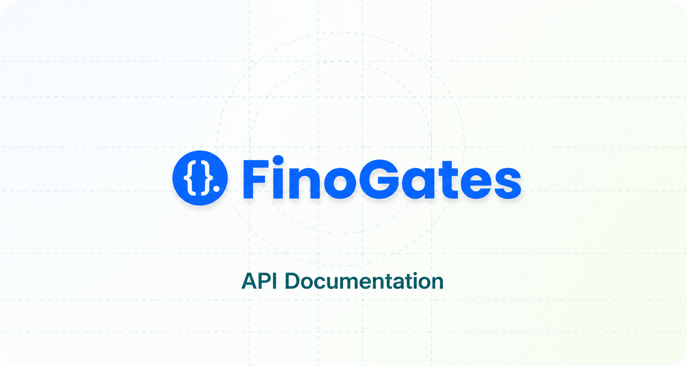
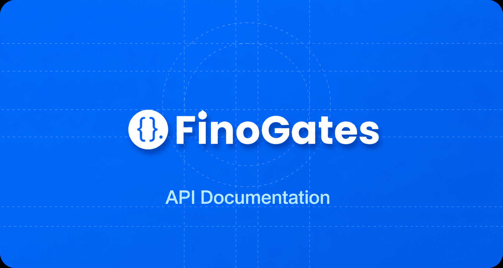

The Finogates API adds payment tools to your app. It is built for speed and simplicity.

Use it to create fast, reliable financial systems. You can:

- Manage users
- Handle payments and process transactions
- Automate approvals
- Do much more

The API is made for developers and businesses that want simpler payment workflows.

---

Need help? Contact **support@finogates.com**
